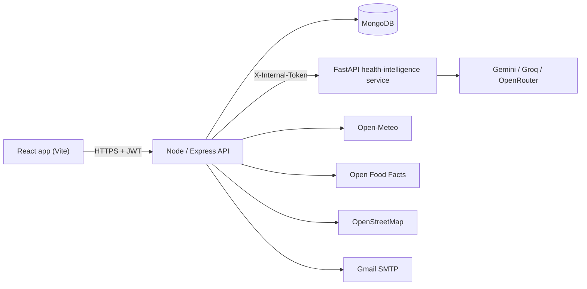

# PranexusAI

Preventive health for people in Bengaluru. PranexusAI turns a short health profile and a daily log into validated risk scores, reads meal photos and grocery bills with AI, shows live air quality on India's own AQI scale, and can alert your family with your location in an emergency.

Every feature runs on real data from free sources. When an AI provider is down, features fall back to clearly labelled rules instead of pretending.

> PranexusAI gives general wellness information. It is not a medical device and does not diagnose. In an emergency call **112** (or **108** for an ambulance).

## Features

| Feature | What it does | Where the data comes from |
| --- | --- | --- |
| Risk assessment | Type 2 diabetes risk, 10-year heart and stroke risk with heart age, BMI on Asian cut-offs, blood-pressure category, sleep and activity bands | Indian Diabetes Risk Score (Mohan et al., 2005); Framingham BMI model (D'Agostino et al., 2008); WHO Asia-Pacific BMI; 2017 ACC/AHA BP categories. Computed in code; AI only writes the explanation |
| Daily log and trends | One entry per day for steps, sleep, BP, heart rate, weight, water, stress, with 14-day charts | Your entries, or a Bluetooth heart-rate monitor |
| Health chat | Answers stream in word by word, use your profile and last week's logs, and cite numbered sources | Gemini / Groq / OpenRouter free tiers; facts retrieved from 1,016 [MedlinePlus](https://medlineplus.gov) topics (BM25 + embeddings); rule-based and AI emergency checks run before any text is shown |
| Lab reports | Upload a photo or PDF of a blood test: each value is marked in or out of range, explained with a source, and charted across reports | The AI only copies the printed table; code matches 30 common tests, converts units, rejects impossible values and judges against the lab's printed range |
| Reminders | Medicine, water and check-up reminders as notifications, even with the app closed | Web Push (VAPID) through the browser's own push service; a scheduler that sends each slot exactly once |
| Meal photo | Identifies each item (Indian dishes included), estimates portion and nutrients, scores the meal 0-10 with reasons, logs it | Vision model for recognition; totals and score computed in code from WHO diet guidance |
| Barcode scan | Camera, photo or typed barcode, then Nutri-Score, NOVA group, allergens, additives, nutrients and a review for you | [Open Food Facts](https://world.openfoodfacts.org) |
| Grocery bill | Reads a receipt, list or bag photo; rates every item and the whole basket | Vision model |
| Goals | Turns "walk 8,000 steps a day" into a weekly plan; progress is measured from your log | AI plan with code-enforced safety limits (max 1 kg/week weight loss) |
| Environment | Live AQI on the CPCB NAQI scale, weather, UV, alerts, and the best 2-hour window to be outside | [Open-Meteo](https://open-meteo.com) weather and CAMS air quality; [Nominatim](https://nominatim.org) place names |
| Vitals | Live heart rate and HRV (RMSSD) from a Bluetooth chest strap or watch, manual readings, a labelled demo simulator | Web Bluetooth GATT Heart Rate service |
| Emergency | Rule-based vital-sign alerts, hold-to-SOS that emails contacts your location and nearest hospitals and prepares WhatsApp/SMS messages, first-aid guides | Gmail SMTP; [OpenStreetMap](https://www.openstreetmap.org) via Overpass |
| Doctors | Symptom triage (which specialist, how urgently), real clinics nearby, appointment tracking with calendar reminders | AI triage after an emergency check; OpenStreetMap clinics; `.ics` files |
| 3D body | Organ models coloured by your own lab results and scores, with the numbers behind each colour | Your lab reports, risk analysis, log and air-quality history |

Guest mode creates a real, isolated account that is deleted after 24 hours, so anyone can try every feature without signing up.

## Architecture



- **Node API** owns auth, validation (zod), rate limits, MongoDB and calls to the public data APIs. It also serves the built React app in production.
- **Python service** is stateless and private. It holds the LLM client, the risk formulas and the safety rules, so each is unit-tested in isolation.
- **One LLM client, three free providers.** Every provider speaks the OpenAI chat format. Calls fall back automatically on rate limits, bad keys, timeouts or invalid JSON, and every answer carries the model that produced it, which the UI shows.
- **Safety first.** Chest pain, stroke signs, breathing trouble, anaphylaxis and suicidal thoughts are caught by fixed rules before any model runs, so emergency guidance works even with every AI provider down.

## Run it locally

Requirements: Node 20+, Python 3.11+.

```bash
npm run install:all          # root, client, server and Python packages
cp server/.env.example server/.env
cp ai-service/.env.example ai-service/.env   # add at least one AI key
cp client/.env.example client/.env
npm run dev                  # API :5001, web :3000, AI :8000
```

Open http://localhost:3000 and choose **Try it as a guest**.

With no `MONGODB_URI`, the API starts a temporary in-memory MongoDB. With no Gmail credentials, verification codes are printed in the API console. With no AI key, AI features fall back to rules and say so.

Or run everything in Docker (MongoDB included): `docker compose up --build`, then open http://localhost:5001.

## Keys

All optional for local development; all free.

| Variable | Where | Get it |
| --- | --- | --- |
| `GEMINI_API_KEY` | `ai-service/.env` | [Google AI Studio](https://aistudio.google.com/apikey) (text and images) |
| `GROQ_API_KEY` | `ai-service/.env` | [Groq console](https://console.groq.com/keys) (fast text fallback) |
| `OPENROUTER_API_KEY` | `ai-service/.env` | [OpenRouter](https://openrouter.ai/keys) (free models, text and images) |
| `MONGODB_URI` | `server/.env` | [MongoDB Atlas](https://www.mongodb.com/cloud/atlas/register) free M0 cluster |
| `GMAIL_USER`, `GMAIL_PASSWORD` | `server/.env` | A Gmail address and a 16-character [App Password](https://myaccount.google.com/apppasswords) |
| `GOOGLE_CLIENT_ID` (+ `VITE_GOOGLE_CLIENT_ID`) | `server/.env`, `client/.env` | [Google Cloud credentials](https://console.cloud.google.com/apis/credentials), OAuth client for a web app |
| `JWT_SECRET`, `AI_INTERNAL_TOKEN` | both `.env` files | Any long random strings; the token must match in both services |
| `VAPID_PUBLIC_KEY`, `VAPID_PRIVATE_KEY`, `VAPID_SUBJECT` | `server/.env` | `npx web-push generate-vapid-keys` (reminders; temporary keys are used in development) |

## Tests

```bash
npm test                                   # server (Jest) + AI service (pytest)
node scripts/smoke-test.mjs http://localhost:5001/api   # live end-to-end check
```

- **AI service, 91 tests:** risk formulas against hand calculations; LLM fallback and streaming with a mocked transport; red-flag rules and the AI safety layer; retrieval and citations; lab-report unit conversion, range parsing and look-alike test names; internal-token enforcement.
- **API, 51 tests** against an in-memory MongoDB: auth and OTP lockout, mass-assignment protection, cross-user isolation, streaming relay, lab reports re-checked on save, the reminder scheduler (sent once, catch-up after sleep, weekdays, dead devices removed), account deletion.
- **AI evaluation harness** (`ai-service/evals`): red-flag recall, triage accuracy and retrieval quality on labelled datasets, with results in `ai-service/evals/README.md`.
- **CI** runs both suites and the client build on every push (`.github/workflows/ci.yml`).

## Deploy (Render, free)

`render.yaml` defines two free web services: the Node app (API + React build) and the AI service. In Render choose **New → Blueprint**, select this repo, then fill in the variables Render asks for: `MONGODB_URI`, `AI_SERVICE_URL` (the AI service's public URL), `CLIENT_URL`, the AI keys and, optionally, Gmail and Google sign-in. `JWT_SECRET` and the shared `AI_INTERNAL_TOKEN` are generated for you.

Free instances sleep after 15 minutes idle, so the first request afterwards takes about a minute. Reminders are sent up to 30 minutes late after a sleep; a free pinger such as [cron-job.org](https://cron-job.org) hitting `/api/ping` every 10 minutes keeps them on time.

## Project layout

```
client/         React + Vite app (pages/, components/, services/api.js)
server/         Express API (routes/, services/, models/, middleware/, tests/)
ai-service/     FastAPI service (app/llm.py, app/risk.py, app/safety.py, app/routers/, tests/)
scripts/        live end-to-end smoke test
```

## Data and credits

Map and clinic data © OpenStreetMap contributors (ODbL). Product data from Open Food Facts (ODbL). Weather and air-quality data from Open-Meteo (CC BY 4.0).

3D models from Sketchfab, all licensed [CC BY 4.0](http://creativecommons.org/licenses/by/4.0/):

| Model | Author |
| --- | --- |
| [Digestive System, Human Anatomy](https://sketchfab.com/3d-models/digestive-system-human-anatomy-f078cef244ec481e93013982a5393ffe) | [adimed](https://sketchfab.com/adimed) |
| [Human Brain](https://sketchfab.com/3d-models/human-brain-7a27c17fd6c0488bb31ab093236a47fb) | [3DRT STUDIOS](https://sketchfab.com/Hanako.com) |
| [Human Eye](https://sketchfab.com/3d-models/human-eye-b68ae822b45443edb812950993ece362) | [DEGUIDER](https://sketchfab.com/DEGUIDER) |
| [Human liver and gallbladder](https://sketchfab.com/3d-models/human-liver-and-gallbladder-6c4e9bd0d49f4828b804259330c0c6c4) | [ElliotSS](https://sketchfab.com/ElliotSS) |
| [Male Body Muscular System](https://sketchfab.com/3d-models/male-body-muscular-system-anatomy-study-991eb96938be4d0d8fadee241a1063d3) | [Ruslan Gadzhiev](https://sketchfab.com/ruslangadzhiev) |
| [Male Human Skeleton](https://sketchfab.com/3d-models/male-human-skeleton-zbrush-anatomy-study-665890c542be433fb18ef235cf987cef) | [Ruslan Gadzhiev](https://sketchfab.com/ruslangadzhiev) |
| [The human kidney](https://sketchfab.com/3d-models/medicine-organ-the-human-kidney-54bd93f545064617bbef79013efd2192) | [Safiya](https://sketchfab.com/thepersonS) |
| [Realistic Human Heart](https://sketchfab.com/3d-models/realistic-human-heart-3f8072336ce94d18b3d0d055a1ece089) | [neshallads](https://sketchfab.com/neshallads) |
| [Realistic Human Lungs](https://sketchfab.com/3d-models/realistic-human-lungs-ce09f4099a68467880f46e61eb9a3531) | [neshallads](https://sketchfab.com/neshallads) |

Originally built by a team at Build for Bangalore; see the repository's contributor list.
